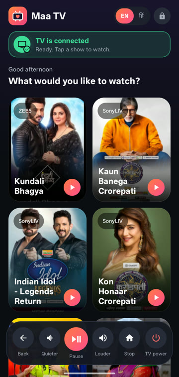
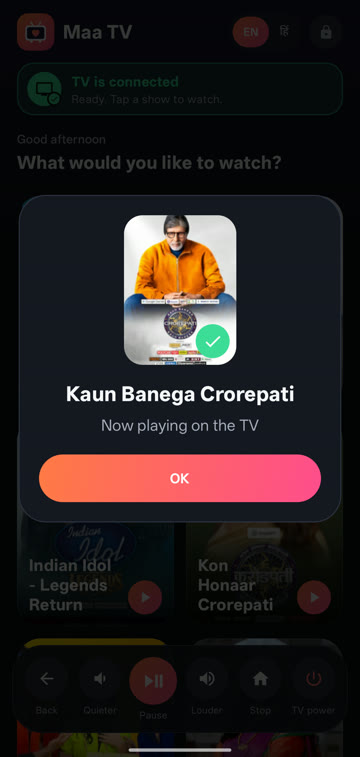
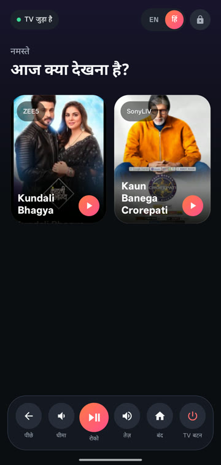
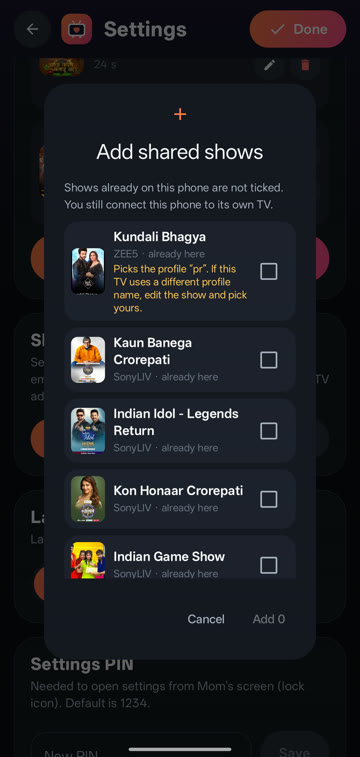

<p align="center">
  
</p>

<h1 align="center">Maa TV</h1>

<p align="center"><b>My mom couldn't use our smart TV, so I built her an app.</b><br/>
She taps a show on her phone. The phone drives the TV by itself.</p>

<p align="center">
  <a href="https://github.com/pranathnaik/maa-tv/releases/latest/download/MaaTV.apk"><b>⬇️ Download the app (APK)</b></a>
  ·
  <a href="https://github.com/pranathnaik/maa-tv/releases/latest">All releases</a>
  ·
  <a href="docs/maa-tv-promo.mp4">Watch the 35-second video</a>
</p>

<p align="center">
  
</p>

## What it does

Smart TVs have too many apps, profile screens, and searching means typing with a remote.
Maa TV turns all of that into **one tap**:

1. Mom's phone shows her shows as big posters.
2. She taps one.
3. The phone takes over the TV over Wi-Fi: opens the app (SonyLIV, ZEE5, …), picks the profile,
   searches, opens the show and presses **Watch Latest Episode** / **Resume**.
4. About 15–25 seconds later, her show is playing. No remote, no help needed.

<p>
  
  
  
  
</p>

**Also:**
- English / हिंदी with one switch
- Big remote buttons on the phone: volume, pause, back, stop, TV power
- A clear "TV is connected" status that updates by itself
- Share all shows with another family phone as one file (no re-recording)
- A PIN-locked Settings screen, so Mom never ends up there by accident

## Requirements

- An **Android phone** (Android 8 or newer)
- A **Google TV / Android TV** on the same Wi-Fi (tested on a Toshiba Google TV, Android TV 11)
- The streaming apps you want, installed and signed in on the TV (tested with SonyLIV and ZEE5)

## Set up (one time, about 5 minutes)

**On the TV**
1. Settings → System → About → click **Android TV OS build** 7 times (turns on developer options).
2. Settings → System → Developer options → turn on **USB debugging**.

**On the phone**
1. [Download the APK](https://github.com/pranathnaik/maa-tv/releases/latest/download/MaaTV.apk) and open it.
   Android will ask to allow installing apps from your browser or file manager — allow it, then **Install**.
2. Open Maa TV → Settings → **Find TV** (or type the TV's IP address) → **Connect**.
3. On the TV, tick **Always allow** and press **Allow**.
4. **Add a show**: pick the app, then drive the TV from the live picture on your phone —
   tap your profile, search the show name, tap the show, and (optionally) tap **Play episode**.
   Name it, save it. It appears on Mom's screen.

Already have shows on another phone? Settings → **Share shows** there, then **Import shows** here.

## How it works

The phone talks to the TV over Android's debugging connection (ADB over Wi-Fi). A tiny helper runs
on the TV to read what's on screen, so the app can find "Who's watching?", the search box, the
show's poster and the play button by their text, and press them the way a person would.
Each show is a recorded list of steps that is replayed when Mom taps it.

Everything stays on your home Wi-Fi: no account, no server, no data leaves your home.

## Good to know

- Streaming apps change their screens now and then. If a show stops working, open it in
  Settings → Edit and re-record the step that changed.
- A TV software update can turn USB debugging off again; turn it back on and reconnect.
- The app only works while the phone and TV are on the same Wi-Fi.

## Build it yourself

Requires JDK 17 and the Android SDK.

```bash
./gradlew assembleRelease
```

The APK is in `app/build/outputs/apk/release/`. Release builds are signed with the key named in
`~/.maatv-signing/keystore.properties` when it exists, otherwise with your debug key.

`tools/dump/` holds the source of the small on-TV screen helper; its compiled form is
`app/src/main/assets/maatv-dump.dex`.
